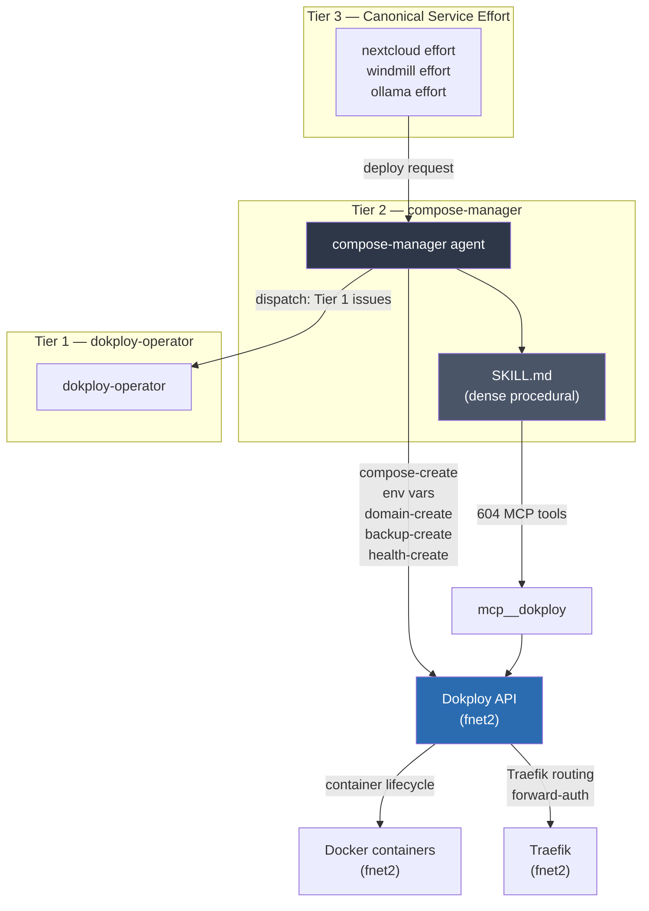
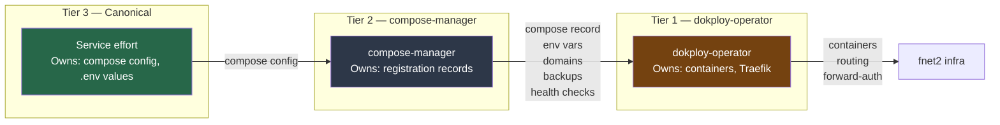
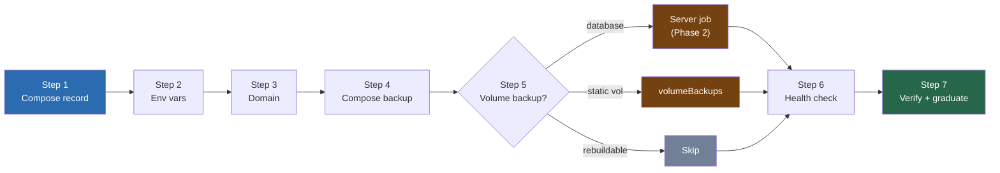
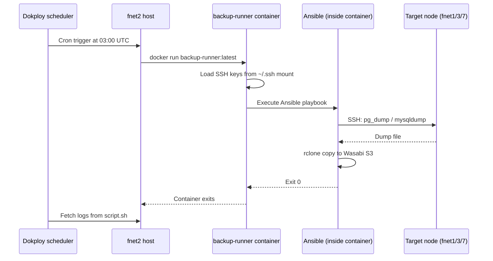

# dokploy-compose-manager — Architecture

> **Purpose:** System architecture, component relationships, and operational runbooks for the compose-manager effort.
> **Audience:** Operators, auditors, future-self. Not the agent — the agent reads SKILL.md.

---

## §1 Abstract

The dokploy-compose-manager is a **Tier 2 operator** in the three-tier Dokploy service model. It owns the complete per-service installation contract: registering compose records, environment variables, domains, backups, schedules, and health checks on the Dokploy PaaS.

The operator sits between two other agents:
- **Tier 3** (canonical service efforts): own the service definition
- **Tier 1** (dokploy-operator): owns container lifecycle

The compose-manager never touches containers, never writes compose configs, and never modifies service environments. It only registers records in Dokploy's database.

---

## §2 Architecture Overview



**Data flow for a new service registration:**
1. Canonical service effort sends deployment request with compose config
2. compose-manager loads service context, reads `config/<service>/docker-compose.yml`
3. compose-manager enumerates existing Dokploy records (ASSESS)
4. compose-manager registers missing records via MCP (REGISTER)
5. compose-manager verifies all 7 steps complete (VERIFY)
6. compose-manager graduates to git + SOT + ChromaDB (GRADUATE)
7. dokploy-operator handles container lifecycle independently

---

## §3 Three-Tier Component Model



### Tier Boundaries

| Tier | Owns | Never touches |
|------|------|--------------|
| Tier 3 | docker-compose.yml content, .env values, service configs | Dokploy API, container lifecycle |
| Tier 2 | Dokploy DB records (compose, env vars, domains, backups, schedules, health) | Container lifecycle, service configs |
| Tier 1 | Container lifecycle, Traefik, forward-auth | Compose config content, .env values |

---

## §4 Service Install Contract



### Backup Decision Matrix

| Service | Volume | Decision | Mechanism |
|---------|--------|---------|-----------|
| Authentik | `authentik-pg-data` | server job | Phase 2 |
| NextCloud | `nextcloud-data` | volumeBackups | Dokploy native |
| NextCloud | `nextcloud_db` | server job | Phase 2 |
| Grafana | `grafana_data` | volumeBackups | Dokploy native |
| Loki | `loki_data` | volumeBackups | Dokploy native |
| SurrealDB | `surrealdb` | server job | Phase 2 |
| Semaphore | `semaphore-mysql` | server job | Phase 2 |
| Windmill | `windmill_db_data` | server job | Phase 2 |

---

## §5 Server Job Execution Model (Phase 2)



**Key properties:**
- Container runs on fnet2 (Dokploy host) using the Docker socket
- Container has SSH keys mounted read-only → reaches all fleet nodes
- Ansible runs inside container → **no Ansible on hosts**
- Logs stream back to Dokploy UI under schedule execution

---

## §6 Operational Runbooks

### Runbook 1: Register a New Service

**Trigger:** Canonical service effort deployment request

**Preconditions:**
- Service compose config exists at `config/<service>/docker-compose.yml`
- `serverId` known (target fnet node)
- S3 destination `wasabi-s3-east-2` registered in Dokploy

**Steps:**
1. Load service effort context
2. ASSESS: enumerate existing records → identify gaps
3. REGISTER: execute missing steps (1–7)
4. VERIFY: confirm all records created
5. GRADUATE: push git, update SOT, store ChromaDB

**Expected outcome:** Service fully registered with all 7 steps complete.

### Runbook 2: Audit Existing Service

**Trigger:** fleet-dispatcher or dokploy-operator dispatch

**Preconditions:** Service name and `composeId` known

**Steps:**
1. Enumerate all existing records for `composeId`
2. Check each against 7-step contract
3. Report gaps (missing env vars, backup rows, health checks, etc.)
4. REGISTER missing steps
5. VERIFY and GRADUATE

**Expected outcome:** All gaps remediated, service fully compliant.

### Runbook 3: Fix composePath Drift

**Trigger:** Uptime-Kuma alert, deployment log error "Compose file not found"

**Diagnosis:**
```bash
mcp__dokploy compose-getConvertedCompose({ composeId: "<id>" })
# Returns NULL → composePath mismatch or git clone issue
```

**Fix:**
1. Verify actual file location on disk: `/etc/dokploy/compose/<appName>/code/<path>`
2. Compare against `composePath` in DB record
3. If mismatch: `compose-update({ composeId, composePath: "<correct>/docker-compose.yml" })`
4. `compose-redeploy` to force re-clone

**Prevention:** composePath convention enforcement at registration time (Step 1).

---

## §7 Component Reference

| Component | Location | Purpose |
|-----------|---------|---------|
| `AGENTS.md` | repo root | Lean operational truth (10 sections) |
| `AGENTS-DEEP.md` | repo root | Dense procedural reference |
| `ARCHITECTURE.md` | repo root | Architecture diagrams, runbooks |
| `SKILL.md` | `skills/dokploy-compose-manager/` | Operator skill (MCP tools, workflows) |
| `agents/dokploy-compose-manager.md` | repo root | Agent config (model, tools, aliases) |
| `QUALITY-METRICS.md` | repo root | Phase 1 quality gate results |

---

## §8 Appendix

### Dokploy API Authentication

All MCP calls use the `x-api-key` header (NOT `Authorization: Bearer` — returns 401).
API key stored in: `pass infrastructure/dokploy/api-key`

### Server IDs

| Node | serverId | Role |
|------|----------|------|
| fnet2 | `fRlHDuz4klcgQ05yX-y8J` | Dokploy primary |
| fnet3 | (varies) | Managed services |
| fnet7 | (varies) | Managed services |

### SSH Keys

- **Deploy key:** `R7VQAMIqCoLqs2E3rr1ff` — registered in Dokploy for git SSH auth
- **Disk operations:** `~/.ssh/github-id_rsa` — friasc user's GitHub key on fnet2
